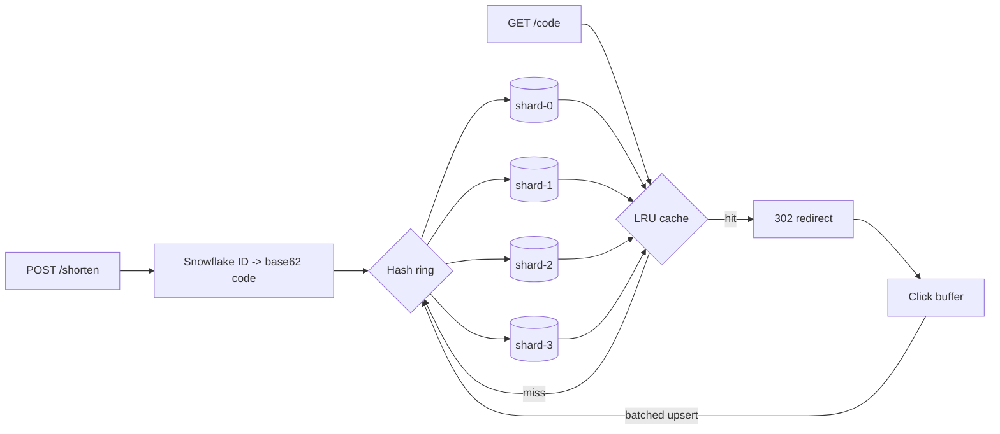

# url-shortener-service

A URL shortener built the way the system-design interview answer describes it, with each part implemented, tested and measured rather than drawn as a box.

No runtime dependencies for the core. Python 3.10+. `uvicorn` only to serve HTTP.

## The parts

| Part | Problem it solves | File |
|---|---|---|
| Snowflake IDs + base62 | Unique short codes with no central counter and no collision checks | `shortener/ids.py` |
| Consistent-hash ring | Picking a shard, and moving few keys when shards are added | `shortener/ring.py` |
| LRU cache with TTL | Reads vastly outnumber writes; most never need the database | `shortener/cache.py` |
| Batched click analytics | A redirect should not wait on an analytics write | `shortener/service.py` |
| ASGI HTTP API | `POST /shorten`, `GET /{code}`, `GET /stats/{code}` | `shortener/app.py` |



## Measured, not assumed

Output of `python -m shortener` on a shared cloud container: 20,000 links across 4 shards, then 100,000 lookups with Zipf-like popularity.

```json
{
  "links_created": 20000,
  "unique_codes": 20000,
  "code_length": 10,
  "shard_distribution": {"shard-0": 5076, "shard-1": 5291, "shard-2": 5422, "shard-3": 4211},
  "largest_shard_vs_even_split": 1.084,
  "cache": {"capacity": 2000, "hit_rate": 0.695},
  "keys_moved_when_adding_5th_shard": {"consistent_hashing": 0.203, "modulo_hashing": 0.803},
  "single_thread_throughput_per_second": {"shorten": 6470, "resolve": 64715}
}
```

What that shows:

- **Consistent hashing earns its complexity.** Adding a fifth shard moves 20% of keys, close to the ideal 1/5. Plain `hash % N` moves 80%.
- **Shard balance is good, not perfect.** With 128 virtual nodes the busiest shard holds 8% more than an even split and the quietest 16% less. More virtual nodes would tighten this at the cost of memory.
- **A cache holding 10% of links serves about 70% of reads** under skewed traffic.
- Throughput is single-threaded on shared hardware and will vary. Treat it as an order of magnitude.

## Design decisions

- **302, not 301.** Browsers cache a 301 permanently, so repeat visits would never reach the server and click counts would be wrong.
- **Negative caching.** A lookup for a code that does not exist is cached too, so scanning random codes cannot hammer the database. Creating a link clears that entry, and a test covers the case.
- **Clock going backwards.** The ID generator reuses its last timestamp instead of trusting a clock that stepped back, so it never issues a duplicate. Tested by freezing and rewinding a fake clock.
- **Only `http` and `https` targets.** `javascript:` and other schemes are rejected so a short link cannot become a script-injection vector.
- **Clicks can be lost on a crash.** Up to one unflushed batch lives in memory. That is an accepted trade for fast redirects; analytics here are approximate by design, links are not.

## Run it

```bash
pip install -e ".[dev]"
pytest -q                     # 21 tests
python -m shortener           # the measurements above

pip install -e ".[serve]" && uvicorn shortener.app:app
curl -s -X POST localhost:8000/shorten -d '{"url": "https://example.com/some/long/path"}'
curl -i localhost:8000/<code>
curl -s localhost:8000/stats/<code>

docker build -t shortener . && docker run -p 8000:8000 shortener
```

## What a production version would add

Shards here are SQLite files on one machine, which demonstrates the routing but not network failure. A real deployment would put shards on separate database servers with replicas, move the cache to Redis so API replicas share it, and send clicks through a queue instead of an in-process buffer. Rebalancing existing rows when a shard joins is also not implemented: the ring tells you which keys should move, but nothing moves them yet.
